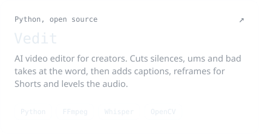
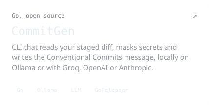

<picture><source media="(prefers-color-scheme: dark)" srcset="./assets/banner-dark.svg" /><source media="(prefers-color-scheme: light)" srcset="./assets/banner-light.svg" /></picture>

OpenOrbit builds small, focused open-source tools for developers and creators. Each project solves one job well, ships with a CLI or simple UI, and is free to use and improve.

 

<picture><source media="(prefers-color-scheme: dark)" srcset="./assets/title-projects-dark.svg" /><source media="(prefers-color-scheme: light)" srcset="./assets/title-projects-light.svg" /></picture>

  <a href="https://github.com/OpenOrbitLabs/Vedit"><picture><source media="(prefers-color-scheme: dark)" srcset="./assets/project-vedit-dark.svg" /><source media="(prefers-color-scheme: light)" srcset="./assets/project-vedit-light.svg" /></picture></a>
  <a href="https://github.com/OpenOrbitLabs/CommitGen"><picture><source media="(prefers-color-scheme: dark)" srcset="./assets/project-commitgen-dark.svg" /><source media="(prefers-color-scheme: light)" srcset="./assets/project-commitgen-light.svg" /></picture></a>

Issues, ideas and pull requests are welcome on any project.
